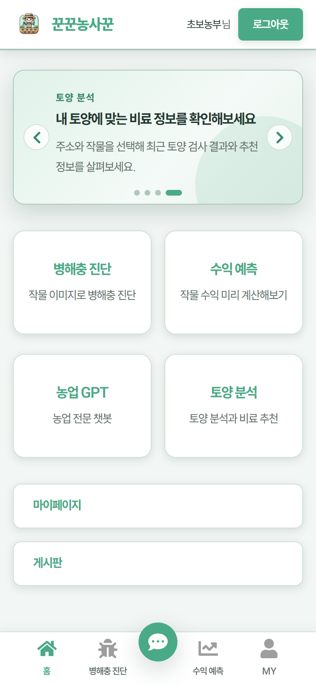
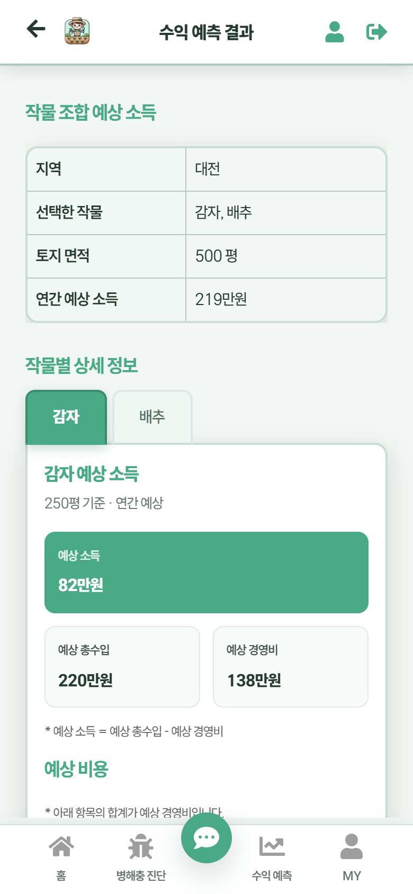
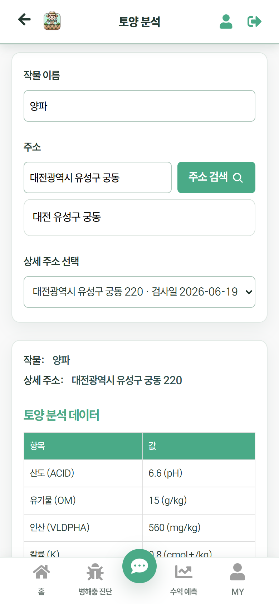
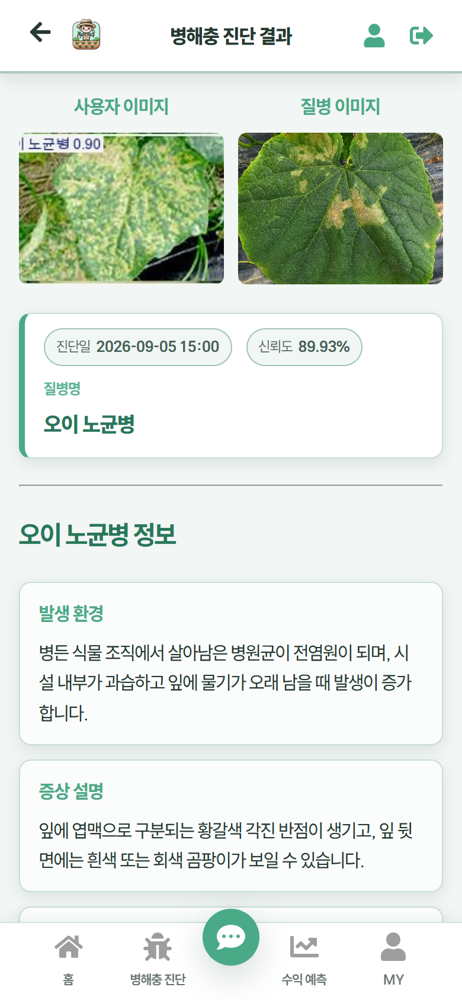

# 농업코파일럿 — 꾼꾼농사꾼

> AI와 공공데이터를 활용해 초보 농업인을 지원하는 서비스입니다.

[](https://github.com/minjuko/farm-copilot/actions/workflows/ci.yml)

2024년 KT AIVLE School 5기 8인 팀 프로젝트로, Collaboration상을 수상했습니다. 프론트엔드 개발에 참여했으며, 이후 실행·보안·테스트를 개인 개선했습니다.

## 프로젝트 개요

| 항목 | 내용 |
| --- | --- |
| 팀 프로젝트 기간 | 2024.06.17–2024.07.30 |
| 팀 구성 | 8명 — 프론트엔드 4 · 백엔드·AI 4 |
| 담당 역할 | 프론트엔드 — 공통 UI, 인증·커뮤니티, 주요 기능 화면과 API 연결 |
| 수상 | KT AIVLE School 5기 Big Project Collaboration상 |
| 원본 저장소 | [프론트엔드](https://github.com/kt-bigproject28/kunkunnongsakun) · [백엔드](https://github.com/kt-bigproject28/bigproject28) |

## 주요 기능 및 화면

<table>
  <tr>
    <th width="50%">메인 화면</th>
    <th width="50%">농작물 수익 분석</th>
  </tr>
  <tr>
    <td align="center"></td>
    <td align="center"></td>
  </tr>
  <tr>
    <th>토양검정·비료 처방</th>
    <th>병해충 진단</th>
  </tr>
  <tr>
    <td align="center"></td>
    <td align="center"></td>
  </tr>
</table>

### 주요 기능

| 기능 | 주요 흐름 |
| --- | --- |
| 농작물 수익 분석 | 작물·지역·재배 조건 입력 → 수익 예측 결과·이력 확인 |
| 병해충 진단 | 이미지 업로드 → YOLO 결과·진단 이력 확인 |
| 토양검정·비료 처방 | 주소·필지 선택 → 토양검정 및 비료 처방 조회 |
| 농업 커뮤니티 | 게시글과 댓글을 작성·조회·수정·삭제합니다. |
| 회원·마이페이지 | 회원가입, 세션 로그인, 계정과 사용자 활동을 관리합니다. |
| 농업 챗봇 | RAG 상담·이력 화면 |

## 기술 스택

| 영역 | 기술 |
| --- | --- |
| 웹 화면 | React 18, JavaScript, React Router 6, Axios, styled-components, Chart.js, Create React App (`react-scripts` 5) |
| 서버 API | Python 3.11 환경, Django 5 JSON views, 세션·CSRF 인증 |
| 로컬 데이터·파일 | SQLite, Django filesystem storage |
| 분석·AI 선택 runtime | scikit-learn ElasticNet, YOLOv8, PyTorch |
| 챗봇 선택 runtime | LangChain, Chroma, OpenAI |
| 외부 자료 연동 코드 | Kakao 주소, aT 가격, 기상청 ASOS, 농촌진흥청 토양검정·비료 처방 API |
| 자동화 | Jest, React Testing Library, Playwright Chromium, axe-core, Ruff, GitHub Actions |


## 담당 역할 및 핵심 구현

- **팀 프로젝트 당시 담당:** 공통 UI·인증·마이페이지·커뮤니티와 병해충 진단·토양검정 화면 및 API 연동에 참여했습니다.
- **수익 분석 관련 기여:** 수익 예측 기능은 다른 팀원이 먼저 구현했으며, 이후 개인 개선 과정에서 관련 화면·API 연동과 검증을 보완했습니다.
- **개인 개선 — 보안:** 진단 이미지를 비공개 저장하고 세션 인증·소유권 검증을 보강했습니다.
- **개인 개선 — 안정성:** 외부 API 응답 계약과 운영 설정, YOLO·챗봇 준비 상태 및 오류 경계를 검증했습니다.
- **개인 개선 — 품질:** Jest·Django·Playwright·axe 및 GitHub Actions 기반 회귀 검증을 보강했습니다.

구조와 인증 흐름은 [아키텍처 문서](docs/ARCHITECTURE.md)를 참고하세요.

## 실행 방법

새 clone의 설정과 실제 Windows PowerShell/POSIX 명령은 [Local Setup Guide](docs/SETUP.md)에 있습니다. 최소 실행 순서는 다음과 같습니다.

```powershell
cd backend
py -3.11 -m venv .venv
.\.venv\Scripts\python.exe -m pip install -r requirements.txt
Copy-Item .env.example .env
```

`.env`에 로컬 전용 `DJANGO_SECRET_KEY`, SQLite, localhost origin을 설정한 뒤:

```powershell
.\.venv\Scripts\python.exe manage.py migrate
.\.venv\Scripts\python.exe manage.py runserver
```

별도 terminal에서:

```powershell
cd frontend
npm ci
Copy-Item .env.example .env
npm start
```

`.env.example`은 값이 들어 있는 `.env`를 생성하지 않습니다. 챗봇, YOLO, 외부 농업 API는 기본 설치·실행과 별도이며 Setup 문서의 선택 기능 안내를 확인하세요.

## 테스트 및 검증

React Jest **191개(32 suites)**, Django **284개 통과·1개 skip**를 확인했습니다. GitHub Actions [run #74](https://github.com/minjuko/farm-copilot/actions/runs/42618994134)에서 Frontend·Backend·Browser E2E가 모두 성공했습니다.

- **프론트엔드:** 토양검정의 오래된 성공·실패 응답 차단, 진단 결과·오류 상태 등 회귀 검증
- **백엔드:** 예측 입력 검증, 세션 소유권, 진단 이력 및 이미지 접근 제어 검증
- **브라우저:** Chromium E2E 40개 통과·2개 skip
- **정적 검사:** Ruff lint·format, Django check, ESLint, 프론트엔드 production build 통과

상세 검증 기록은 [예측·토양검정 감사](docs/PREDICTION_SOIL_AUDIT_2026-11-09.md), [병해충 탐지 감사](docs/DETECTION_FAILURE_AND_ACCESS_AUDIT_2026-11-09.md), [브라우저 E2E](docs/FRONTEND_E2E.md)에 정리했습니다.

## 공개 Git 이력의 자격증명 안내

과거 공개 Git 이력의 로그에서 AWS Access Key ID 형식 문자열이 확인됐습니다. 사용자 확인에 따르면 프로젝트에서 사용한 AWS 키는 폐기·만료됐고 API 키도 교체됐습니다. 다만 감사에서 발견한 문자열과 폐기·교체한 키의 일치 여부는 검증하지 않아 **개별 키 상태는 미확인**입니다. 해당 로그가 포함된 이력에서는 짝을 이루는 Secret Access Key 값을 확인하지 못했습니다.

## 관련 문서

| 문서 | 근거와 절차 |
| --- | --- |
| [Local Setup](docs/SETUP.md) | 로컬 실행, 환경변수, 선택 기능 및 최종 검증 |
| [Architecture](docs/ARCHITECTURE.md) | 라우트, 세션 인증, API 및 데이터 흐름 |
| [AI detection operations](docs/AI_DETECTION_OPERATIONS.md) | artifact readiness, 비공개 이미지, 격리 테스트 |
| [병해충 탐지 감사](docs/DETECTION_FAILURE_AND_ACCESS_AUDIT_2026-11-09.md) | 예외 처리 및 접근 권한 검증 |
| [Chatbot operations](docs/CHATBOT_OPERATIONS.md) | RAG readiness, 개인정보, 비용·장애 경계 |
| [Frontend E2E](docs/FRONTEND_E2E.md) | fixture/Django 테스트 구분, axe, 모바일 에뮬레이션 |
