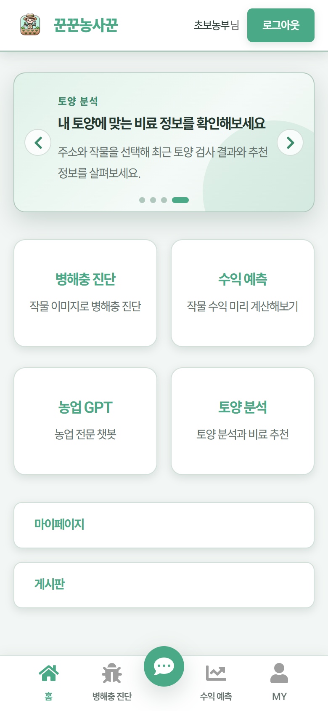
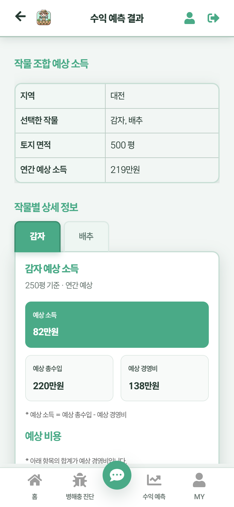
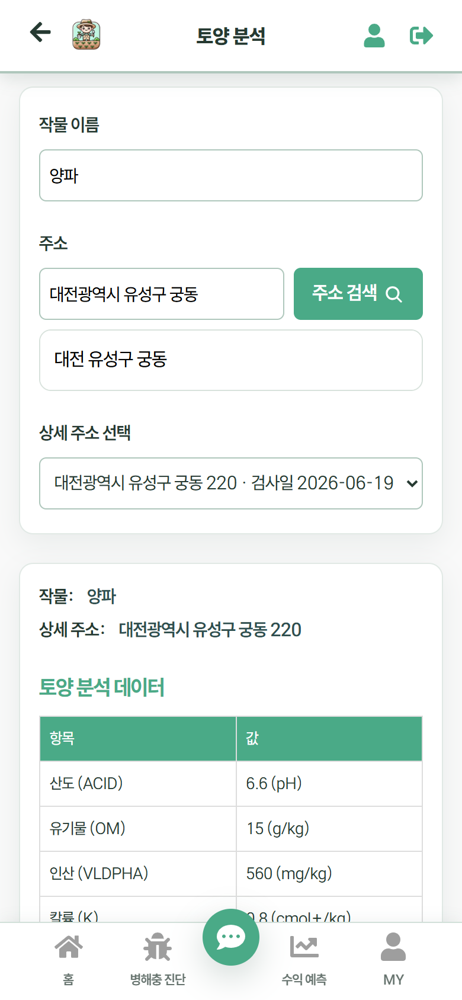
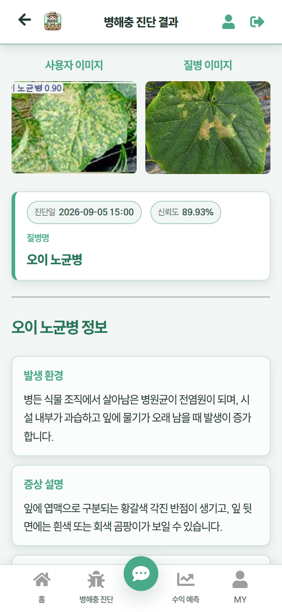

# 농업코파일럿 — 꾼꾼농사꾼

> 초보 농업인의 작물 선택과 영농 판단을 돕기 위해 수익 분석, 병해충 진단, 토양검정, 커뮤니티와 상담 화면을 제공하는 웹 서비스입니다.

[](https://github.com/minjuko/farm-copilot/actions/workflows/ci.yml)

2024년 KT AIVLE School 5기 6인 팀 프로젝트로, Collaboration상을 수상했습니다. 프론트엔드 개발에 참여했으며, 이후 실행·보안·테스트를 개인 개선했습니다.

## 프로젝트 개요

| 항목 | 내용 |
| --- | --- |
| 팀 프로젝트 기간 | 2024.06.17–2024.07.30 |
| 팀 구성 | 6명 — 프론트엔드 2 · 백엔드 2 · AI/Server 2 |
| 담당 역할 | 프론트엔드 — 공통 UI, 인증·커뮤니티, 주요 기능 화면과 API 연결 |
| 수상 | KT AIVLE School 5기 Big Project Collaboration상 |
| 원본 저장소 | [프론트엔드](https://github.com/kt-bigproject28/kunkunnongsakun) · [백엔드](https://github.com/kt-bigproject28/bigproject28) |

## 주요 기능 및 화면

<table>
  <tr>
    <th width="50%">메인 화면</th>
    <th width="50%">농작물 수익 분석</th>
  </tr>
  <tr>
    <td align="center"></td>
    <td align="center"></td>
  </tr>
  <tr>
    <th>토양검정·비료 처방</th>
    <th>병해충 진단</th>
  </tr>
  <tr>
    <td align="center"></td>
    <td align="center"></td>
  </tr>
</table>

이미지는 팀 프로젝트 최종 시연 자료를 바탕으로 구성했습니다.

### 주요 기능

| 기능 | 흐름과 현재 경계 |
| --- | --- |
| 농작물 수익 분석 | 작물·지역·재배 조건 입력 → 수익 예측 결과·이력 확인 |
| 병해충 진단 | 이미지 업로드 → YOLO 결과·진단 이력 확인 (모델 파일 필요) |
| 토양검정·비료 처방 | 주소·필지 선택 → 토양검정 및 비료 처방 조회 |
| 농업 커뮤니티 | 게시글과 댓글을 작성·조회·수정·삭제합니다. |
| 회원·마이페이지 | 회원가입, 세션 로그인, 계정과 사용자 활동을 관리합니다. |
| 농업 챗봇 | RAG 상담·이력 화면 (기본 비활성화, 별도 설정 필요) |

## 기술 스택

| 영역 | 기술 |
| --- | --- |
| 웹 화면 | React 18, JavaScript, React Router 6, Axios, styled-components, Chart.js, Create React App (`react-scripts` 5) |
| 서버 API | Python 3.11 환경, Django 5 JSON views, 세션·CSRF 인증 |
| 로컬 데이터·파일 | SQLite, Django filesystem storage |
| 설정으로 지원하는 선택 구성 | PostgreSQL, S3 (실제 운영 연결·버킷 정책은 검증하지 않음) |
| 분석·AI 선택 runtime | scikit-learn ElasticNet, YOLOv8, PyTorch; YOLO 의존성은 별도 `requirements-ai.txt` |
| 챗봇 선택 runtime | LangChain, Chroma, OpenAI; 기본 비활성화, 실제 유료 호출 미검증 |
| 외부 자료 연동 코드 | Kakao 주소, aT 가격, 기상청 ASOS, 농촌진흥청 토양검정·비료 처방 API |
| 자동화 | Jest, React Testing Library, Playwright Chromium, axe-core, Ruff, GitHub Actions |


## 담당 역할 및 핵심 구현

- **담당 역할:** 공통 UI·인증·마이페이지·커뮤니티 및 수익 분석·병해충·토양검정 입력과 결과 화면을 API에 연결했습니다.
- **개인 개선 — 보안:** 진단 이미지를 비공개 저장하고 세션 인증·소유권 검증을 보강했습니다.
- **개인 개선 — 안정성:** 외부 API 응답 계약과 운영 설정, YOLO·챗봇 준비 상태 및 오류 경계를 검증했습니다.
- **개인 개선 — 품질:** Jest·Django·Playwright·axe 및 GitHub Actions 기반 회귀 검증을 보강했습니다.

구조와 인증 흐름은 [아키텍처 문서](docs/ARCHITECTURE.md)를 참고하세요.

## 실행 방법

새 clone의 설정과 실제 Windows PowerShell/POSIX 명령은 [Local Setup Guide](docs/SETUP.md)에 있습니다. 최소 실행 순서는 다음과 같습니다.

```powershell
cd backend
py -3.11 -m venv.venv
.\.venv\Scripts\python.exe -m pip install -r requirements.txt
Copy-Item.env.example.env
```

`.env`에 로컬 전용 `DJANGO_SECRET_KEY`, SQLite, localhost origin을 설정한 뒤:

```powershell
.\.venv\Scripts\python.exe manage.py migrate
.\.venv\Scripts\python.exe manage.py runserver
```

별도 terminal에서:

```powershell
cd frontend
npm ci
Copy-Item.env.example.env
npm start
```

`.env.example`은 값이 들어 있는 `.env`를 생성하지 않습니다. 챗봇, YOLO, 외부 농업 API는 기본 설치·실행과 별도이며 Setup 문서의 선택 기능 안내를 확인하세요.

## 테스트 및 검증

FC10 최종 검증은 2026-10-28에 로컬에서 재실행했습니다. 최종 GitHub Actions #46에서도 Frontend·Backend·Browser E2E가 모두 성공했습니다.

| 검사 | 결과 | 검증 경계 |
| --- | --- | --- |
| Frontend Jest | 32 suites, 188 tests 통과 | UI·API 모듈 단위/컴포넌트 테스트 |
| Backend Django | 278개 중 277 통과, 1 skip | 기본은 mock 기반, 모델 opt-in 테스트는 기본 skip |
| Ruff lint·format, Django check, `pip check` | 통과 | 정적 검사 및 격리 테스트 DB |
| Playwright Chromium | 42개 중 40 통과, 2 skip | fixture 흐름 + 격리 Django session/CSRF/소유권; 실제 YOLO 아님 |
| axe 자동 검사 | 로그인·커뮤니티에서 자동 위반 0건 | 스크린리더 평가를 대체하지 않음 |
| 모바일 viewport | 320×640, 390×844 통과 | 브라우저 에뮬레이션, 실제 기기 아님 |
| GitHub Actions | [실행 내역](https://github.com/minjuko/farm-copilot/actions)에서 Frontend · Backend · Browser E2E 성공 확인 | 공개 CI |
| npm audit | 31건; production dependency 2건 | 세부 내용은 아래 알려진 한계 참고 |

Playwright에는 fixture 기반 화면 테스트와 격리 Django 인증·소유권 테스트가 포함되며, 운영 서비스 검증은 아닙니다.

## 알려진 한계와 보안 위험

- **모델 성능:** YOLO 체크포인트의 실제 CPU 실행은 FC07에서 한 참고 이미지로 확인했지만 정확도·일반화 성능은 검증하지 않았습니다. ID 2와 4의 원천 라벨 관계도 미해결입니다. 자세한 내용은 [모델 현황](docs/DETECTION_MODEL.md)을 참고하세요.
- **공개 Git 이력:** 과거 자격 증명으로 보이는 값과 모델 가중치의 공개 이력 위험이 남아 있습니다. 사용 중일 수 있는 자격 증명은 폐기·교체하고 모델 재배포 권리를 확인해야 합니다. [감사 기록](docs/FC10_PORTFOLIO_EVIDENCE.md#공개-저장소-위험)
- **의존성:** npm audit 전체 31건, production dependency 2건이 남아 있습니다. 세부 위험은 [감사 기록](docs/FC10_PORTFOLIO_EVIDENCE.md)을 참고하세요.
- **운영 검증:** PostgreSQL·S3·외부 농업 API·OpenAI·실기기 연동은 검증하지 않았습니다.

## 관련 문서

| 문서 | 근거와 절차 |
| --- | --- |
| [Local Setup](docs/SETUP.md) | 로컬 실행, 환경변수, 선택 기능 및 최종 검증 |
| [Architecture](docs/ARCHITECTURE.md) | 라우트, 세션 인증, API 및 데이터 흐름 |
| [Detection model](docs/DETECTION_MODEL.md) | YOLO 계약, 매핑, 학습 provenance와 공개 이력 한계 |
| [AI detection operations](docs/AI_DETECTION_OPERATIONS.md) | artifact readiness, 비공개 이미지, 격리 테스트 |
| [Chatbot operations](docs/CHATBOT_OPERATIONS.md) | RAG readiness, 개인정보, 비용·장애 경계 |
| [Frontend E2E](docs/FRONTEND_E2E.md) | fixture/Django 테스트 구분, axe, 모바일 에뮬레이션 |
| [Repository 검증 근거](docs/FC10_PORTFOLIO_EVIDENCE.md) | 팀 기여·개인 개선 및 FC01–FC10 검증 기록 |
