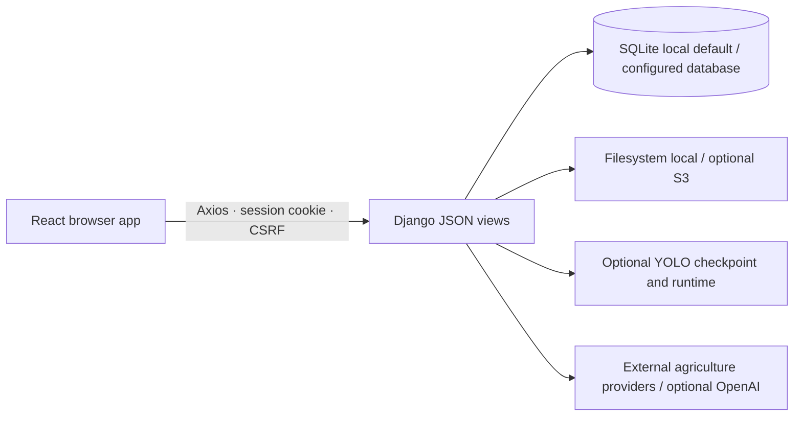

# 현재 코드 아키텍처

2026-10-28 기준 Repository 코드를 조사해 정리했습니다. 실제 배포 아키텍처나 외부 서비스 가용성을 뜻하지 않습니다.

## 시스템 개요

프론트엔드는 React SPA이며 진입점과 라우트는 `frontend/src/App.js`, `frontend/src/routes/`에 있습니다. Backend route는 `backend/config/urls.py`에서 Django 앱별 URL로 연결됩니다. 현재 앱의 API는 Django view와 `JsonResponse`를 사용합니다. Django REST Framework는 dependency와 setting에 있지만 활성 DRF view·serializer·router는 확인되지 않았습니다.

기본 로컬 설정은 SQLite와 filesystem storage입니다. PostgreSQL과 S3는 설정 경로가 있지만 실제 운영 연결은 검증하지 않았습니다.

## 화면 라우트와 요청

- `userRoutes.jsx`: 시작·메인·가입·로그인·약관·마이페이지 경로
- `analysisRoutes.jsx`: 작물 예측, 진단 업로드·이력·상세, 토양검정, 챗봇 경로
- `communityRoutes.jsx`: 게시판 종류, 게시글 상세·작성·수정 및 사용자 게시글
- `AuthContext.js`: `/login/auth_check/`로 세션 상태를 확인하고 인증 대기·로그인·비로그인 상태를 제공합니다.
- `AuthRoute`와 `NoAuthRoute`: 인증 사용자 전용 경로와 로그인 사용자 제한 경로를 보호합니다.
- `apis/client.js`: `REACT_APP_API_BASE_URL`, `withCredentials`, Django CSRF cookie의 `X-CSRFToken` 전달 및 공통 401 처리를 설정합니다. 기본 요청 timeout은 50초입니다.
- API 모듈은 `user.js`, `post.js`, `crop.js`, `predict.js`, `chat.js`, `capabilities.js` 등으로 나뉩니다. `predict.js`는 진단과 토양 관련 호출을 함께 포함하므로 도메인별 완전한 1:1 분리는 아닙니다.

## 주요 데이터 흐름

### 수익 예측

브라우저가 작물·지역·재배 입력을 보내면 Django prediction view/service가 외부 가격·기상 자료를 확인하고 ElasticNet 분석을 수행합니다. 외부 Provider 설정과 응답 상태에 따라 기능이 제한될 수 있습니다. Mock 검증과 실제 Provider 검증은 구분하며 이번 검증에서 실제 농업 API는 호출하지 않았습니다.

### 토양검정·비료 처방

주소 검색 후 필지를 선택하고 Django soil API가 토양검정·비료 처방 자료를 요청합니다. Kakao 및 농촌진흥청 API 설정이 필요할 수 있으며 실제 외부 응답은 이번 검증 범위에 포함하지 않았습니다.

### 병해충 진단과 이미지 보호

1. 브라우저는 JPEG·PNG·WebP 업로드를 검증하고 미리보기를 표시합니다.
2. 로그인 세션과 CSRF를 포함해 `POST /detect/upload/`에 `image` multipart 파일을 전송합니다.
3. Django가 이미지 크기·디코딩·픽셀 한도, AI runtime과 모델 계약을 검사한 후 YOLO 추론을 수행합니다.
4. 기준을 넘긴 Box 중 최고 confidence를 선택해 class ID를 Pest 정보에 연결하고 이력과 이미지를 저장합니다.
5. 브라우저는 응답과 이력 목록·상세를 표시합니다. 원본 사용자 이미지는 공개 media URL 대신 `GET /detect/detection_image/<session_id>/` 인증 endpoint에서 스트리밍합니다.

진단 목록·상세·삭제와 이미지 조회는 로그인 사용자 소유권으로 제한됩니다. 인증 이미지 응답은 private/no-store와 nosniff 헤더를 사용합니다. S3 구성에서 object ACL은 비공개(None)를 요청하지만 bucket policy와 외부 CDN·proxy 동작은 검증하지 않았습니다.

Checkpoint에는 6개 출력 ID가 있고 fixture에서는 5개 Pest code를 사용합니다. ID 2와 4가 같은 Pest로 매핑된 이유는 원천 학습자료가 없어 미해결입니다. 0.60 confidence threshold는 분류 정확도나 calibrated probability를 의미하지 않습니다. [모델 문서](./DETECTION_MODEL.md)와 [운영 문서](./AI_DETECTION_OPERATIONS.md)에 artifact와 provenance 경계를 기록했습니다.

### 챗봇·RAG

챗봇 UI와 Django endpoint는 존재하지만 `CHATBOT_ENABLED` 기본값은 false입니다. 활성화에는 OpenAI 키, 선택 runtime과 준비된 로컬 Chroma index가 필요합니다. 준비 상태 API는 로컬 설정과 index manifest를 확인하며 원격 OpenAI 가용성·결제·실제 답변을 검사하지 않습니다. 질문과 대화 일부가 OpenAI로 전달될 수 있습니다. 이력은 사용자 계정에 저장되고 기본 자동 만료 정책은 없습니다. [챗봇 운영 문서](./CHATBOT_OPERATIONS.md)에 개인정보·비용·장애 경계를 기록했습니다.

## 외부 연동의 검증 범위

저장소에는 Kakao 주소 검색, aT 가격, 기상청 ASOS, 농촌진흥청 토양·비료 처방과 OpenAI 요청 코드가 있습니다. 계약 테스트는 fixture/mock 기반입니다. 이 문서 갱신 과정과 FC10 검증에서는 운영 key, 실제 외부 endpoint, 유료 호출을 사용하지 않았습니다.

## 자동 검증의 경계

- **Jest:** 컴포넌트·API helper의 mock 기반 단위/통합 테스트
- **Playwright fixture:** React 화면과 fixture 응답 흐름. 실제 Django API 호출이 아닙니다.
- **격리 Django E2E:** 새 임시 root·SQLite·Media·Private Media와 별도 계정을 사용해 session, CSRF, 이미지 소유권·응답 헤더를 확인합니다. YOLO 추론은 실행하지 않습니다.
- **실제 YOLO opt-in:** 별도 체크포인트가 있는 로컬 격리 테스트에서 수행합니다. 공개 CI 기본 실행은 model file 없이 skip합니다. FC07 기록은 한 참고 이미지 실행성 확인이며 정확도 평가가 아닙니다.
- **axe·모바일:** axe는 선택한 화면의 자동 규칙 검사이고 스크린리더 사용성 증명이 아닙니다. 320×640·390×844는 브라우저 에뮬레이션이며 실제 기기 검증이 아닙니다.

## 소스 지도

| 영역 | 주요 파일 |
| --- | --- |
| React 진입점·라우트 | `frontend/src/App.js`, `frontend/src/routes/` |
| 인증·HTTP Client | `frontend/src/AuthContext.js`, `frontend/src/apis/client.js`, `frontend/src/apis/user.js` |
| 진단 화면·응답 | `frontend/src/components/templates/exam/DiagnosisTemplate.jsx`, `frontend/src/apis/predict.js`, `frontend/src/components/templates/exam/detectFlow.js` |
| Django URL·설정 | `backend/config/urls.py`, `backend/config/settings.py` |
| 진단 API·저장 | `backend/detect/urls.py`, `backend/detect/views.py`, `backend/common/storage_backends.py` |
| 챗봇 | `backend/chatbot/`, `docs/CHATBOT_OPERATIONS.md` |
| 테스트·CI | `frontend/e2e/`, `.github/workflows/ci.yml`, `docs/FRONTEND_E2E.md` |
