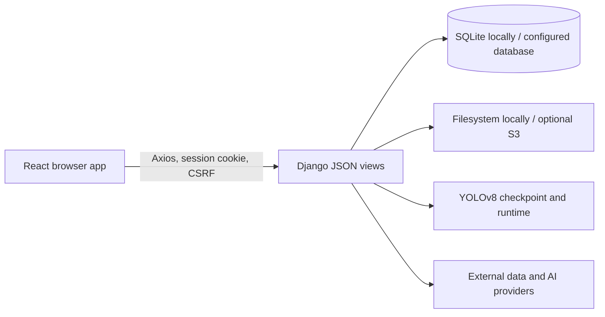

# Farm Copilot Architecture

This document describes the repository as inspected on 2026-10-21. It records the current implementation, not an intended production deployment.

## System outline

The browser app is a React single page application. `frontend/src/App.js` installs loading and authentication providers and React Router. Backend routes are mounted by `backend/config/urls.py`. The current backend endpoints inspected here use Django views and `JsonResponse`; Django REST Framework is installed and listed in settings, but no active DRF view, serializer, or router usage was found in the inspected Python application code.

Local configuration defaults to SQLite and filesystem media. PostgreSQL and S3 are configurable alternatives. This repository review did not verify a production deployment or live S3 integration.

## Frontend structure and request flow

- `frontend/src/App.js` defines the application entry and route groups.
- `frontend/src/AuthContext.js` checks `/login/auth_check/` and tracks checking, authenticated, and unauthenticated states. `AuthRoute` and `NoAuthRoute` guard routes.
- `frontend/src/apis/client.js` configures Axios with `REACT_APP_API_BASE_URL`, credentials, CSRF cookie forwarding, and centralized 401 handling.
- `frontend/src/apis/predict.js` groups detection and soil calls in one module; API modules are not strictly one-per-domain.
- `frontend/src/components/templates/exam/DiagnosisTemplate.jsx` validates an image, previews it locally, checks detection capability, submits it, and navigates to the result. `frontend/src/components/templates/exam/detectFlow.js` contains response normalization and validation helpers.
- Diagnosis list and detail templates call the session list/detail/delete APIs and render empty, loading, and error states.

Shared application state inspected here uses React Context. Redux should not be claimed for this implementation.

## Authentication and request security

The frontend uses Django session authentication rather than a JWT flow. Axios sends credentials and forwards the CSRF cookie as `X-CSRFToken`; Django login/logout and authenticated views manage the session. Detection session queries are scoped to the current user, and a detail request for another user's session is returned as not found. Local and production cookie, CORS, and CSRF settings differ; see [setup](./SETUP.md) before configuring a deployment.

## Detection flow

1. The browser accepts a JPEG, PNG, or WebP image and performs client-side validation and preview.
2. The browser sends the file as `image` in an authenticated multipart request to `POST /detect/upload/`.
3. Django validates the image, checks the YOLO runtime and model/class contract, and performs inference.
4. The service selects the highest-confidence box meeting the configured 0.60 threshold, maps its class ID to a database disease record, and stores the session and image.
5. The frontend validates and normalizes the response and displays diagnosis details and history.

The six model class IDs map to five unique disease records; IDs 2 and 4 both map to cucumber downy mildew. A returned confidence is the model score for the selected detection, not measured accuracy or a calibrated disease probability. Full endpoint, readiness, error, and model details live in [AI detection operations](./AI_DETECTION_OPERATIONS.md) and [detection model reference](./DETECTION_MODEL.md).

## Other backend paths

The repository also contains Django applications for accounts, community, soil, crop income prediction, chatbot, and shared API capabilities. The income prediction path uses an ElasticNet artifact. Chatbot indexing and external providers have separate configuration and credentials; their availability depends on environment setup. This architecture summary does not assert live external-provider or production behavior.

## Local versus experimental model work

The YOLO checkpoint used by the service and the independent model-training / AI Hub data-preparation materials are different workstreams. Experimental datasets or training scripts do not establish that the service checkpoint was trained on those data, nor do they demonstrate model accuracy. See the model evaluation documentation under `backend/evaluation/` for evaluation scope and limitations.

## Source map

| Concern | Main source locations |
| --- | --- |
| React entry and routes | `frontend/src/App.js`, `frontend/src/routes/` |
| Auth and API client | `frontend/src/AuthContext.js`, `frontend/src/apis/client.js`, `frontend/src/apis/user.js` |
| Diagnosis UI and API | `frontend/src/components/templates/exam/DiagnosisTemplate.jsx`, `frontend/src/apis/predict.js`, `frontend/src/components/templates/exam/detectFlow.js` |
| Django route mounting | `backend/config/urls.py` |
| Detection endpoints and inference | `backend/detect/urls.py`, `backend/detect/views.py` |
| Detection model contract and readiness | `backend/detect/`, `docs/AI_DETECTION_OPERATIONS.md`, `docs/DETECTION_MODEL.md` |
| Local configuration | `backend/config/settings.py`, `backend/.env.example` |
| Evaluation limitations | `backend/evaluation/README.md`, `backend/evaluation/VALIDATION.md` |
